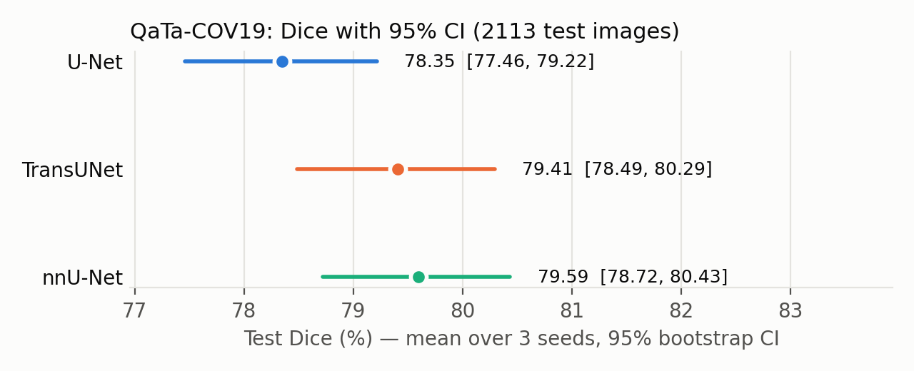
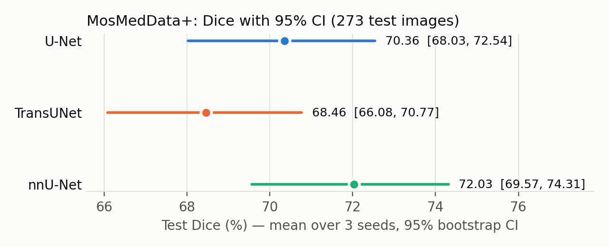
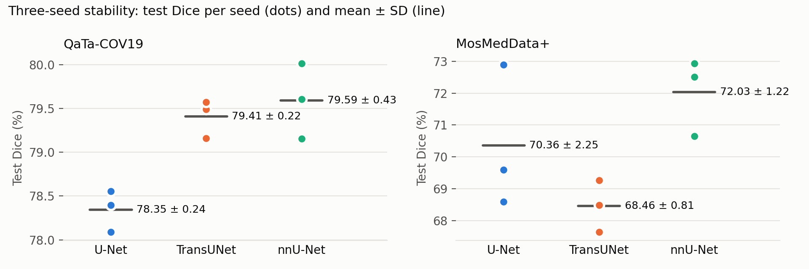

# Phase 0: Image-Only Segmentation Benchmark — Results

This file follows the structure of the Phase 0 instructions. Each task briefly describes what was done, fills in
the task's table with the actual results, and the file ends with the findings and conclusions.

## Goal

Establish a strong and reproducible image-only benchmark on the two datasets used by the later language-guided
experiments.

- **Methods:** U-Net, TransUNet, nnU-Net.
- **Datasets:** QaTa-COV19 and MosMedData+, both with the LViT split.
- **Seeds:** 1001, 1002, 1003.
- **Runs:** 3 methods × 2 datasets × 3 seeds = 18 runs.
- **Metrics:** Dice (primary); mIoU, HD95 and ASSD (secondary).

Status: **complete**. All 18 runs are finished and evaluated, and every checklist item is met.

---

# Public Implementations

All three methods use their official public code, pinned to a fixed version in `external/`. The upstream code is
not modified. Small wrappers in `src/` handle data loading, seeds and checkpoint selection.

| Method | Implementation | Version |
|---|---|---|
| U-Net | U-Net distributed with LViT (`HUANGLIZI/LViT`, `nets/UNet.py`) | commit `ba90775` |
| TransUNet | official `Beckschen/TransUNet`, R50-ViT-B_16 | commit `02ef001` |
| nnU-Net | official `MIC-DKFZ/nnUNet` v2, 2D configuration | v2.8.1 |

---

# Task 0.1: Create the Project and Download the Data

The project repository was created with the recommended structure (`external/`, `src/`, `configs/`, `data/`,
`runs/`, `results/`, `reports/`). Raw datasets are not stored in GitHub. The images and masks come from the
QaTa-COV19 and MosMedData+ archives. The LViT split files from the dataset package were checked against the LViT
Google Drive folder, and their contents are identical. The official LViT splits are used unchanged; no new split
was created.

| Dataset | Train | Validation | Test |
|---|---:|---:|---:|
| QaTa-COV19 | 5716 | 1429 | 2113 |
| MosMedData+ | 2183 | 273 | 273 |

Checks: every split ID has an image and a mask, there are no duplicates, and no ID appears in two splits.
Details: `reports/PHASE0_DATA_SUMMARY.md`.

---

# Task 0.2: Prepare One Common Segmentation Dataset

One common preparation step (`src/data/prepare_common.py`) produces the 224×224 images and masks that every method
uses. It follows the official LViT loader exactly:
- images are resized to 224×224 with OpenCV, as in the loader;
- masks are resized the same way and then binarized (mask ≤ 0 → 0, mask > 0 → 1);
- images are stored as one grayscale channel, and methods that need 3 channels duplicate it.

All methods train and test on exactly these files.

| Dataset | Original size | Prepared images | Prepared masks |
|---|---|---|---|
| QaTa-COV19 | 224×224, 1 channel | 224×224 grayscale (9258) | 224×224, {0, 1} |
| MosMedData+ | 512×512, 3 identical channels | 224×224 grayscale (2729) | 224×224, {0, 1} |

---

# Task 0.3: Set Up the Three Models

Configurations: `configs/unet.yaml`, `configs/transunet.yaml`, `configs/nnunet.yaml`. Each method keeps its
intended training strategy. The only change is that every method selects its checkpoint by **validation Dice**,
computed the same way for all methods. No setting was chosen using test performance.

| Method | Source | Configuration | Input | Pretraining | Notes |
|---|---|---|---|---|---|
| U-Net | LViT | binary U-Net (1 output, sigmoid) | 224×224 | none | LViT recipe: Dice + BCE loss, Adam, lr 3e-4, batch 2, early stopping (patience 50) |
| TransUNet | Official | R50-ViT-B_16 | 224×224 | ImageNet-21k (official weights) | official recipe: CE + Dice loss, SGD, lr 0.01, batch 24, 150 epochs; validation added for checkpoint selection |
| nnU-Net | Official | 2D | 224×224 prepared data | none | default plans and trainer (1000 epochs); checkpoint chosen by full validation Dice instead of nnU-Net's own patch-based score |

**Quick check.** For each method and dataset, the check loaded one batch, ran a forward pass, verified the output
and mask shapes and the loss, and ran a short training on a small subset. All six checks passed and validation
Dice rose during the short training. Details: `reports/PHASE0_MODEL_SETUP.md`.

---

# Task 0.4: Run the 18 Main Experiments

All 18 runs were trained on RTX 3090 GPUs (Oct 20 – Nov 4, 2026). Each cell shows that the run is complete
(✅) and its test Dice (%).

| Method | Dataset | Seed 1001 | Seed 1002 | Seed 1003 |
|---|---|---|---|---|
| U-Net | QaTa-COV19 | ✅ 78.09 | ✅ 78.40 | ✅ 78.55 |
| TransUNet | QaTa-COV19 | ✅ 79.16 | ✅ 79.49 | ✅ 79.57 |
| nnU-Net | QaTa-COV19 | ✅ 80.02 | ✅ 79.15 | ✅ 79.61 |
| U-Net | MosMedData+ | ✅ 72.89 | ✅ 68.60 | ✅ 69.59 |
| TransUNet | MosMedData+ | ✅ 69.26 | ✅ 67.64 | ✅ 68.48 |
| nnU-Net | MosMedData+ | ✅ 72.50 | ✅ 72.94 | ✅ 70.65 |

Every run saved its training log, best checkpoint (by validation Dice), test summary, per-case metrics
(`sample_id`, `dice`, `miou`, `hd95`, `assd`) and predicted masks, in `runs/<method>/<dataset>/seed_<seed>/`.
These files are kept on the server, not in git. Three runs interrupted by a server failure were restarted from
scratch.

---

# Task 0.5: Common Final Evaluation

All 18 runs are scored by one evaluator (`src/evaluation/evaluate.py`) on the same test images and the same target
masks:
- evaluation size 224×224, binary threshold 0.5;
- metrics Dice, mIoU, HD95 and ASSD, with HD95 and ASSD in 224×224 pixel units;
- if a prediction is empty while the image has a lesion, HD95 and ASSD are set to the image diagonal (316.8 px).

All predictions are produced at 224×224, so no resampling was needed. A consistency check over all 18 runs
confirmed identical test IDs and targets, identical settings, and exact agreement between stored and recomputed
metrics.

---

# Task 0.6: Summarize the Results

Outputs: `results/phase0_main_results.csv`, `reports/PHASE0_RESULTS.md`.
- Dice and mIoU are in %; HD95 and ASSD are in pixels (lower is better).
- Mean ± SD is across the 3 seeds.
- Dice 95% CI is a bootstrap over test images (10,000 resamples) of the seed-averaged per-image Dice.

| Dataset | Method | Dice Mean ± SD | Dice 95% CI | mIoU | HD95 | ASSD |
|---|---|---|---|---:|---:|---:|
| QaTa-COV19 | U-Net | 78.35 ± 0.24 | [77.46, 79.22] | 68.73 ± 0.25 | 32.30 ± 0.66 | 11.02 ± 0.49 |
| QaTa-COV19 | TransUNet | 79.41 ± 0.22 | [78.49, 80.29] | 70.27 ± 0.15 | 29.02 ± 0.37 | 9.41 ± 0.99 |
| QaTa-COV19 | nnU-Net | 79.59 ± 0.43 | [78.72, 80.43] | 70.23 ± 0.49 | 29.29 ± 1.10 | 9.08 ± 1.14 |
| MosMedData+ | U-Net | 70.36 ± 2.25 | [68.03, 72.54] | 57.44 ± 2.05 | 27.14 ± 6.69 | 12.97 ± 6.47 |
| MosMedData+ | TransUNet | 68.46 ± 0.81 | [66.08, 70.77] | 55.21 ± 0.82 | 25.93 ± 3.01 | 12.12 ± 3.48 |
| MosMedData+ | nnU-Net | 72.03 ± 1.22 | [69.57, 74.31] | 59.58 ± 1.11 | 22.86 ± 2.80 | 9.48 ± 3.03 |

---

# Task 0.7: Pairwise Comparison

Output: `results/phase0_pairwise_comparisons.csv`. For each pair, the method is:
1. each test image's Dice is averaged across the 3 seeds within each method;
2. the same images are aligned;
3. the paired difference A − B is computed (in percentage points).

- **95% CI:** paired bootstrap over test images.
- **p:** two-sided Wilcoxon signed-rank test.
- **Holm:** correction across the 3 comparisons within each dataset.

| Dataset | Method A | Method B | ΔDice | 95% CI | Raw p | Holm p |
|---|---|---|---:|---|---:|---:|
| QaTa-COV19 | U-Net | TransUNet | −1.06 | [−1.45, −0.66] | 1.3e-22 | 4.0e-22 |
| QaTa-COV19 | U-Net | nnU-Net | −1.25 | [−1.66, −0.84] | 4.1e-21 | 8.1e-21 |
| QaTa-COV19 | TransUNet | nnU-Net | −0.19 | [−0.62, 0.24] | 0.019 | 0.019 |
| MosMedData+ | U-Net | TransUNet | +1.90 | [−0.22, 4.00] | 3.4e-4 | 6.7e-4 |
| MosMedData+ | U-Net | nnU-Net | −1.67 | [−3.71, 0.26] | 0.55 | 0.55 |
| MosMedData+ | TransUNet | nnU-Net | −3.57 | [−4.66, −2.43] | 7.8e-17 | 2.4e-16 |

The CI and the Wilcoxon test agree clearly in three cases:
- on QaTa-COV19, TransUNet and nnU-Net are both better than U-Net;
- on MosMedData+, nnU-Net is better than TransUNet.

In two cases the test is significant but the CI includes 0: TransUNet vs nnU-Net on QaTa-COV19, and U-Net vs
TransUNet on MosMedData+. These are small or uncertain differences. U-Net vs nnU-Net on MosMedData+ is not
significant.

---

# Required Figures

1. QaTa-COV19 Dice comparison with 95% CI

   

2. MosMedData+ Dice comparison with 95% CI

   

3. Three-seed stability for all methods

   

---

# Milestones

| Milestone | Expected | Status |
|---|---|---|
| 0.1 Data Ready | QaTa-COV19 = 5716 / 1429 / 2113; MosMedData+ = 2183 / 273 / 273 | ✅ |
| 0.2 Models Ready | U-Net, TransUNet and nnU-Net 2D run correctly; training settings fixed | ✅ |
| 0.3 18 Runs Complete | 18 / 18 runs complete | ✅ 18 / 18 |
| 0.4 Final Analysis Complete | `results/phase0_main_results.csv`, `results/phase0_pairwise_comparisons.csv`, `reports/PHASE0_RESULTS.md` | ✅ |

---

# Phase 0 Completion Checklist

- [x] QaTa-COV19 uses the LViT split.
- [x] MosMedData+ uses the LViT split.
- [x] U-Net is complete.
- [x] TransUNet is complete.
- [x] nnU-Net is complete.
- [x] all 18 runs are complete.
- [x] all three seeds are included.
- [x] per-case predictions and metrics are saved.
- [x] common 224×224 evaluation is used.
- [x] main result table is complete.
- [x] paired comparisons are complete.
- [x] `PHASE0_RESULTS.md` is complete.

---

# Findings and Conclusions

1. **nnU-Net is the strongest image-only baseline.** It has the highest Dice on both datasets (79.59 on
   QaTa-COV19, 72.03 on MosMedData+).
   - On QaTa-COV19 it is statistically tied with TransUNet, and both beat U-Net by about 1 point.
   - On MosMedData+ it beats TransUNet clearly (+3.6 points). It is ahead of U-Net (+1.7), but that difference is
     not significant.
2. **MosMedData+ is harder and noisier than QaTa-COV19.**
   - Dice is about 8 points lower.
   - Results vary more between seeds (SD 0.8–2.3 vs 0.2–0.4 points), and CIs are wider, because the test set is
     small (273 images) and the lesions are small.
   - The LViT MosMedData+ split is made per slice, so some test slices come from CT scans that also appear in
     training. This may make MosMedData+ scores optimistic. It affects all methods equally.
3. **Boundary metrics (HD95, ASSD) mostly follow Dice.** Their spread between seeds comes mainly from the few
   images where a model misses the lesion entirely.
4. **Implications for Phase 1.**
   - Language-guided methods should be compared mainly against nnU-Net (≈79.6 / ≈72.0 Dice).
   - Differences of about 1 point can be detected reliably on QaTa-COV19. On MosMedData+ a difference needs to be
     about 2–3 points to stand out from noise.

Phase 0 is complete and frozen. Detailed reports: `reports/PHASE0_DATA_SUMMARY.md`,
`reports/PHASE0_MODEL_SETUP.md`, `reports/PHASE0_RESULTS.md`.
