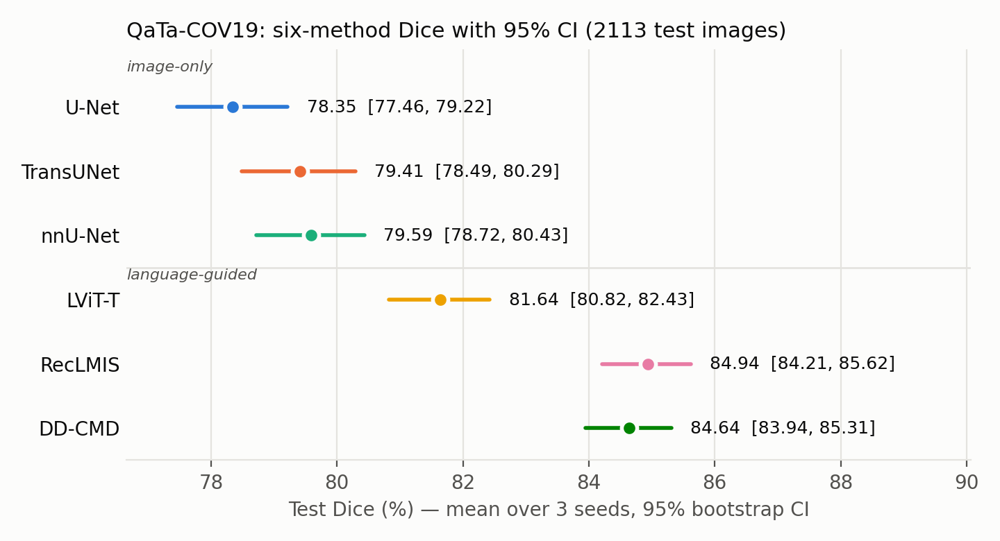
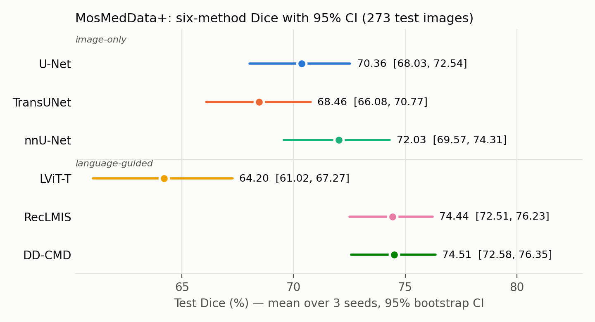
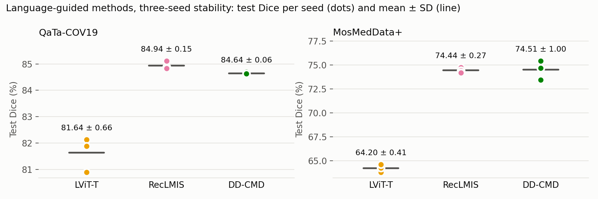
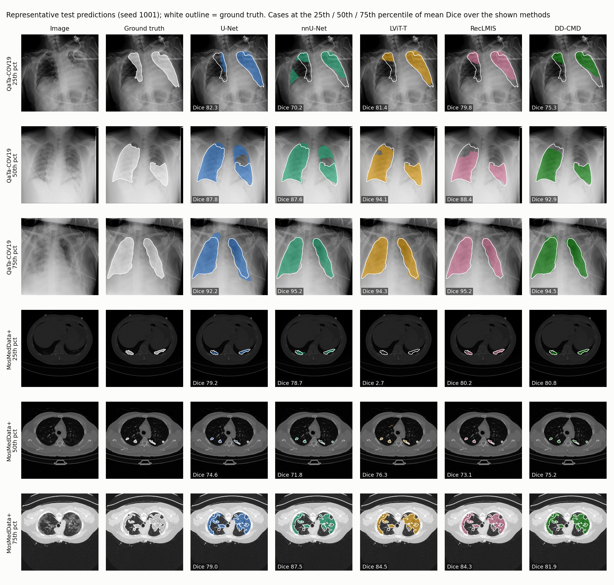

# Phase 1 — Results (Tasks 1.6–1.11)

Language-guided benchmark: LViT-T, RecLMIS and DD-CMD (official implementations, `reports/PHASE1_MODEL_SETUP.md`)
on QaTa-COV19 and MosMedData+ with the official LViT splits, 3 seeds per method (1001, 1002, 1003), 18 runs.
They are compared with the Phase 0 image-only baselines (U-Net, TransUNet, nnU-Net; `reports/PHASE0_RESULTS.md`).

Machine-readable tables (generated by `src/analysis/phase1_results.py`):
`results/phase1_main_results.csv`, `results/final_six_method_results.csv`, `results/final_six_method_pairwise.csv`.
Evaluation check (Task 1.7, `src/checks/check_phase1_evaluation.py`): `results/phase1_evaluation_check.csv`.
Comparison with published results: `results/phase1_published_comparison.csv`.

## Task 1.6: the 18 runs

All 18 runs finished (Nov 14–17, 2026, RTX 3090 GPUs 0–3, queue `src/run_phase1.py`). Each run directory
`runs/<method>/<dataset>/seed_<seed>/` holds the training log (`train.log`, `history.csv`), the best checkpoint
(selected on validation Dice), `test.log`, and `test/` with the predicted masks, `per_case_metrics.csv` and
`test_summary.json` (kept on the server, not in git). The test set was predicted once per run, after training. When
reloaded, every best checkpoint reproduced the validation Dice it was selected with.

| Method | Dataset | Seed 1001 | Seed 1002 | Seed 1003 |
|---|---|---|---|---|
| LViT-T | QaTa-COV19 | ✅ 148 epochs, 22.6 h | ✅ 100 epochs, 15.4 h | ✅ 159 epochs, 24.3 h |
| RecLMIS | QaTa-COV19 | ✅ 181 epochs, 5.5 h | ✅ 170 epochs, 5.2 h | ✅ 191 epochs, 5.8 h |
| DD-CMD | QaTa-COV19 | ✅ 160 epochs, 5.7 h | ✅ 160 epochs, 5.8 h | ✅ 160 epochs, 5.7 h |
| LViT-T | MosMedData+ | ✅ 193 epochs, 11.1 h | ✅ 177 epochs, 10.2 h | ✅ 150 epochs, 9.2 h |
| RecLMIS | MosMedData+ | ✅ 126 epochs, 1.5 h | ✅ 83 epochs, 1.0 h | ✅ 102 epochs, 1.3 h |
| DD-CMD | MosMedData+ | ✅ 74 epochs, 1.0 h | ✅ 98 epochs, 1.3 h | ✅ 94 epochs, 1.3 h |

Hours include test prediction and evaluation. All runs except DD-CMD QaTa-COV19 ended by early stopping.
DD-CMD QaTa-COV19 reached the official maximum of 160 epochs (best epochs 123, 144, 134).

Two infrastructure problems were found while the runs were going. Both were fixed, and the affected runs were
restarted from scratch. No completed run was modified (setup report, Decisions 11–12):
- Nov 14: all LViT-T runs were bound to GPU 0, because the official `Config.py` sets `CUDA_VISIBLE_DEVICES` on
  import. The first attempt was stopped after 35 minutes. The restarted runs reproduced its epoch-1 numbers exactly.
- Nov 16: four DD-CMD runs running at the same time thrashed the CPU (official `num_workers=0` and 128 PyTorch
  threads per process). Their epochs were 15–30× slower. The processes were limited to 8 CPU threads, and all six
  DD-CMD runs were restarted. The training recipe did not change.

## Task 1.7: Common final evaluation

All six methods (36 runs) are scored by one evaluator (`src/evaluation/evaluate.py`):
- predictions at 224×224, lesion = probability ≥ 0.5;
- Dice, mIoU (mean over images of the lesion IoU), and HD95 and ASSD in 224×224 pixels;
- an empty prediction on an image with a lesion gets the image diagonal (316.8 px) as HD95 and ASSD. No test
  target is empty.

The check over all 36 runs confirmed:
- the same test samples in every run: QaTa-COV19 2113 and MosMedData+ 273 images, in split order;
- the same target masks: one hash per dataset;
- one 224×224 binary prediction per test image;
- threshold 0.5 and evaluation size 224 everywhere;
- checkpoints selected on validation Dice;
- every per-case metric equals the value recomputed from the saved prediction (max. difference 3×10⁻¹⁴).

Each method makes its prediction with its own official inference: a single forward pass, except nnU-Net, which
uses sliding window with test-time mirroring. The language-guided methods receive each test image's paired LViT
text annotation.

## Task 1.8: Phase 1 results

Dice and mIoU in %; HD95 and ASSD in pixels (lower is better). Mean ± SD is across the 3 seeds of each run's
test-set mean. Dice 95% CI is a percentile bootstrap over test images (10,000 resamples) of the seed-averaged
per-image Dice. These are the same statistics as Phase 0.

| Dataset | Method | Dice Mean ± SD | Dice 95% CI | mIoU | HD95 | ASSD |
|---|---|---|---|---:|---:|---:|
| QaTa-COV19 | LViT-T | 81.64 ± 0.66 | [80.82, 82.43] | 72.75 ± 0.78 | 20.78 ± 0.71 | 7.94 ± 0.21 |
| QaTa-COV19 | RecLMIS | 84.94 ± 0.15 | [84.21, 85.62] | 76.69 ± 0.19 | 13.53 ± 0.56 | 4.08 ± 0.34 |
| QaTa-COV19 | DD-CMD | 84.64 ± 0.06 | [83.94, 85.31] | 76.20 ± 0.08 | 13.65 ± 0.25 | 3.98 ± 0.11 |
| MosMedData+ | LViT-T | 64.20 ± 0.41 | [61.02, 67.27] | 52.42 ± 0.88 | 44.54 ± 12.19 | 31.95 ± 14.10 |
| MosMedData+ | RecLMIS | 74.44 ± 0.27 | [72.51, 76.23] | 61.59 ± 0.39 | 17.57 ± 1.01 | 5.23 ± 0.16 |
| MosMedData+ | DD-CMD | 74.51 ± 1.00 | [72.58, 76.35] | 61.60 ± 1.04 | 16.76 ± 1.25 | 4.89 ± 0.98 |

### Per-seed test Dice (%)

| Dataset | Method | Seed 1001 | Seed 1002 | Seed 1003 |
|---|---|---:|---:|---:|
| QaTa-COV19 | LViT-T | 82.14 | 80.89 | 81.89 |
| QaTa-COV19 | RecLMIS | 84.88 | 84.82 | 85.11 |
| QaTa-COV19 | DD-CMD | 84.60 | 84.70 | 84.63 |
| MosMedData+ | LViT-T | 63.78 | 64.24 | 64.59 |
| MosMedData+ | RecLMIS | 74.72 | 74.40 | 74.20 |
| MosMedData+ | DD-CMD | 73.44 | 75.42 | 74.67 |

## Task 1.9: Final six-method comparison (main benchmark table)

The Phase 0 rows were recomputed from the saved per-case metrics and are identical to
`results/phase0_main_results.csv`.

| Dataset | Method | Text at Train | Text at Test | Dice Mean ± SD | Dice 95% CI | mIoU | HD95 | ASSD |
|---|---|---|---|---|---|---:|---:|---:|
| QaTa-COV19 | U-Net | No | No | 78.35 ± 0.24 | [77.46, 79.22] | 68.73 ± 0.25 | 32.30 ± 0.66 | 11.02 ± 0.49 |
| QaTa-COV19 | TransUNet | No | No | 79.41 ± 0.22 | [78.49, 80.29] | 70.27 ± 0.15 | 29.02 ± 0.37 | 9.41 ± 0.99 |
| QaTa-COV19 | nnU-Net | No | No | 79.59 ± 0.43 | [78.72, 80.43] | 70.23 ± 0.49 | 29.29 ± 1.10 | 9.08 ± 1.14 |
| QaTa-COV19 | LViT-T | Yes | Yes | 81.64 ± 0.66 | [80.82, 82.43] | 72.75 ± 0.78 | 20.78 ± 0.71 | 7.94 ± 0.21 |
| QaTa-COV19 | RecLMIS | Yes | Yes | **84.94 ± 0.15** | [84.21, 85.62] | **76.69 ± 0.19** | **13.53 ± 0.56** | 4.08 ± 0.34 |
| QaTa-COV19 | DD-CMD | Yes | Yes | 84.64 ± 0.06 | [83.94, 85.31] | 76.20 ± 0.08 | 13.65 ± 0.25 | **3.98 ± 0.11** |
| MosMedData+ | U-Net | No | No | 70.36 ± 2.25 | [68.03, 72.54] | 57.44 ± 2.05 | 27.14 ± 6.69 | 12.97 ± 6.47 |
| MosMedData+ | TransUNet | No | No | 68.46 ± 0.81 | [66.08, 70.77] | 55.21 ± 0.82 | 25.93 ± 3.01 | 12.12 ± 3.48 |
| MosMedData+ | nnU-Net | No | No | 72.03 ± 1.22 | [69.57, 74.31] | 59.58 ± 1.11 | 22.86 ± 2.80 | 9.48 ± 3.03 |
| MosMedData+ | LViT-T | Yes | Yes | 64.20 ± 0.41 | [61.02, 67.27] | 52.42 ± 0.88 | 44.54 ± 12.19 | 31.95 ± 14.10 |
| MosMedData+ | RecLMIS | Yes | Yes | 74.44 ± 0.27 | [72.51, 76.23] | 61.59 ± 0.39 | 17.57 ± 1.01 | 5.23 ± 0.16 |
| MosMedData+ | DD-CMD | Yes | Yes | **74.51 ± 1.00** | [72.58, 76.35] | **61.60 ± 1.04** | **16.76 ± 1.25** | **4.89 ± 0.98** |

Bold: best value per dataset and metric. The differences between the bold value and the second-best are not
significant except for Dice and mIoU on QaTa-COV19 (Task 1.10).

## Task 1.10: Statistical comparison (15 pairs per dataset)

For each dataset:
1. each test image's metric is averaged across the 3 seeds within each method;
2. the same images are aligned;
3. Δ is the mean of (A − B) per image.

- **95% CI:** paired percentile bootstrap over test images (10,000 resamples).
- **p:** two-sided Wilcoxon signed-rank test on the paired per-image Dice.
- **Holm:** correction across the 15 Dice comparisons within each dataset.

ΔDice is in percentage points. Negative values mean that B has the higher Dice.

| Dataset | Method A | Method B | ΔDice | 95% CI | Raw p | Holm p |
|---|---|---|---:|---|---:|---:|
| QaTa-COV19 | U-Net | TransUNet | −1.06 | [−1.45, −0.66] | 1.3e-22 | 8.0e-22 |
| QaTa-COV19 | U-Net | nnU-Net | −1.25 | [−1.65, −0.85] | 4.1e-21 | 2.0e-20 |
| QaTa-COV19 | U-Net | LViT-T | −3.29 | [−3.77, −2.83] | 6.6e-67 | 4.6e-66 |
| QaTa-COV19 | U-Net | RecLMIS | −6.60 | [−7.11, −6.10] | 2.9e-202 | 4.3e-201 |
| QaTa-COV19 | U-Net | DD-CMD | −6.30 | [−6.84, −5.76] | 2.4e-164 | 3.3e-163 |
| QaTa-COV19 | TransUNet | nnU-Net | −0.19 | [−0.61, +0.23] | 0.019 | 0.019 |
| QaTa-COV19 | TransUNet | LViT-T | −2.23 | [−2.75, −1.69] | 3.3e-10 | 1.3e-9 |
| QaTa-COV19 | TransUNet | RecLMIS | −5.53 | [−6.08, −5.00] | 4.6e-118 | 5.6e-117 |
| QaTa-COV19 | TransUNet | DD-CMD | −5.24 | [−5.76, −4.72] | 4.8e-94 | 4.8e-93 |
| QaTa-COV19 | nnU-Net | LViT-T | −2.05 | [−2.56, −1.52] | 9.4e-9 | 2.8e-8 |
| QaTa-COV19 | nnU-Net | RecLMIS | −5.35 | [−5.86, −4.83] | 1.9e-97 | 2.1e-96 |
| QaTa-COV19 | nnU-Net | DD-CMD | −5.05 | [−5.56, −4.55] | 1.7e-83 | 1.3e-82 |
| QaTa-COV19 | LViT-T | RecLMIS | −3.30 | [−3.69, −2.94] | 6.4e-137 | 8.3e-136 |
| QaTa-COV19 | LViT-T | DD-CMD | −3.00 | [−3.40, −2.62] | 1.4e-89 | 1.3e-88 |
| QaTa-COV19 | RecLMIS | DD-CMD | +0.30 | [+0.01, +0.58] | 2.1e-5 | 4.2e-5 |
| MosMedData+ | U-Net | TransUNet | +1.90 | [−0.26, +3.98] | 3.4e-4 | 0.003 |
| MosMedData+ | U-Net | nnU-Net | −1.67 | [−3.69, +0.25] | 0.55 | 1.00 |
| MosMedData+ | U-Net | LViT-T | +6.16 | [+4.20, +8.19] | 5.1e-6 | 5.6e-5 |
| MosMedData+ | U-Net | RecLMIS | −4.08 | [−5.99, −2.29] | 0.003 | 0.018 |
| MosMedData+ | U-Net | DD-CMD | −4.15 | [−6.10, −2.37] | 6.2e-4 | 0.005 |
| MosMedData+ | TransUNet | nnU-Net | −3.57 | [−4.69, −2.46] | 7.8e-17 | 1.0e-15 |
| MosMedData+ | TransUNet | LViT-T | +4.26 | [+0.91, +7.72] | 0.10 | 0.31 |
| MosMedData+ | TransUNet | RecLMIS | −5.98 | [−7.45, −4.57] | 6.8e-20 | 9.5e-19 |
| MosMedData+ | TransUNet | DD-CMD | −6.05 | [−7.43, −4.79] | 2.5e-25 | 3.7e-24 |
| MosMedData+ | nnU-Net | LViT-T | +7.83 | [+4.67, +11.16] | 0.021 | 0.12 |
| MosMedData+ | nnU-Net | RecLMIS | −2.41 | [−3.62, −1.29] | 0.050 | 0.20 |
| MosMedData+ | nnU-Net | DD-CMD | −2.48 | [−3.70, −1.39] | 0.025 | 0.13 |
| MosMedData+ | LViT-T | RecLMIS | −10.24 | [−13.40, −7.26] | 1.5e-4 | 0.002 |
| MosMedData+ | LViT-T | DD-CMD | −10.31 | [−13.47, −7.35] | 2.5e-6 | 3.0e-5 |
| MosMedData+ | RecLMIS | DD-CMD | −0.07 | [−0.83, +0.65] | 0.63 | 1.00 |

### mIoU, HD95 and ASSD: paired differences with 95% CI

ΔmIoU is in percentage points. ΔHD95 and ΔASSD are in pixels; a positive value means that A has the larger
(worse) distance.

| Dataset | Method A | Method B | ΔmIoU (95% CI) | ΔHD95 px (95% CI) | ΔASSD px (95% CI) |
|---|---|---|---|---|---|
| QaTa-COV19 | U-Net | TransUNet | −1.54 [−1.94, −1.13] | +3.27 [+2.13, +4.42] | +1.62 [+0.76, +2.55] |
| QaTa-COV19 | U-Net | nnU-Net | −1.49 [−1.93, −1.05] | +3.01 [+1.90, +4.13] | +1.95 [+1.09, +2.84] |
| QaTa-COV19 | U-Net | LViT-T | −4.02 [−4.50, −3.53] | +11.52 [+10.05, +13.02] | +3.08 [+1.89, +4.31] |
| QaTa-COV19 | U-Net | RecLMIS | −7.95 [−8.48, −7.43] | +18.76 [+17.28, +20.31] | +6.94 [+5.84, +8.15] |
| QaTa-COV19 | U-Net | DD-CMD | −7.47 [−8.01, −6.93] | +18.65 [+17.16, +20.18] | +7.05 [+5.96, +8.25] |
| QaTa-COV19 | TransUNet | nnU-Net | +0.04 [−0.44, +0.50] | −0.26 [−1.36, +0.79] | +0.33 [−0.46, +1.10] |
| QaTa-COV19 | TransUNet | LViT-T | −2.48 [−3.02, −1.93] | +8.24 [+6.79, +9.75] | +1.47 [+0.32, +2.60] |
| QaTa-COV19 | TransUNet | RecLMIS | −6.42 [−6.97, −5.88] | +15.49 [+14.14, +16.90] | +5.32 [+4.40, +6.29] |
| QaTa-COV19 | TransUNet | DD-CMD | −5.93 [−6.49, −5.38] | +15.37 [+13.98, +16.74] | +5.43 [+4.58, +6.38] |
| QaTa-COV19 | nnU-Net | LViT-T | −2.52 [−3.06, −1.98] | +8.50 [+7.10, +9.92] | +1.14 [+0.09, +2.20] |
| QaTa-COV19 | nnU-Net | RecLMIS | −6.46 [−7.02, −5.90] | +15.75 [+14.43, +17.12] | +4.99 [+4.17, +5.89] |
| QaTa-COV19 | nnU-Net | DD-CMD | −5.97 [−6.52, −5.44] | +15.64 [+14.31, +16.96] | +5.10 [+4.32, +5.93] |
| QaTa-COV19 | LViT-T | RecLMIS | −3.94 [−4.31, −3.57] | +7.25 [+6.21, +8.33] | +3.86 [+2.92, +4.88] |
| QaTa-COV19 | LViT-T | DD-CMD | −3.45 [−3.84, −3.06] | +7.13 [+6.08, +8.24] | +3.97 [+3.07, +4.98] |
| QaTa-COV19 | RecLMIS | DD-CMD | +0.49 [+0.18, +0.80] | −0.12 [−0.66, +0.43] | +0.11 [−0.24, +0.49] |
| MosMedData+ | U-Net | TransUNet | +2.23 [+0.21, +4.19] | +1.21 [−4.33, +6.64] | +0.86 [−4.56, +6.31] |
| MosMedData+ | U-Net | nnU-Net | −2.14 [−4.08, −0.26] | +4.28 [−0.64, +9.24] | +3.49 [−1.42, +8.35] |
| MosMedData+ | U-Net | LViT-T | +5.02 [+3.33, +6.74] | −17.40 [−24.53, −10.66] | −18.98 [−26.42, −12.15] |
| MosMedData+ | U-Net | RecLMIS | −4.15 [−5.99, −2.42] | +9.57 [+5.53, +13.99] | +7.74 [+4.02, +12.00] |
| MosMedData+ | U-Net | DD-CMD | −4.16 [−6.00, −2.42] | +10.38 [+6.12, +15.00] | +8.08 [+4.31, +12.47] |
| MosMedData+ | TransUNet | nnU-Net | −4.37 [−5.52, −3.23] | +3.07 [+0.26, +6.34] | +2.63 [+0.22, +5.57] |
| MosMedData+ | TransUNet | LViT-T | +2.79 [−0.15, +5.83] | −18.61 [−27.96, −9.57] | −19.83 [−28.72, −10.98] |
| MosMedData+ | TransUNet | RecLMIS | −6.38 [−7.72, −5.05] | +8.36 [+3.86, +13.57] | +6.89 [+2.49, +11.95] |
| MosMedData+ | TransUNet | DD-CMD | −6.39 [−7.69, −5.16] | +9.17 [+5.07, +13.98] | +7.23 [+3.38, +11.76] |
| MosMedData+ | nnU-Net | LViT-T | +7.16 [+4.31, +10.12] | −21.68 [−30.51, −13.14] | −22.47 [−31.51, −13.93] |
| MosMedData+ | nnU-Net | RecLMIS | −2.00 [−3.19, −0.87] | +5.28 [+1.44, +9.74] | +4.25 [+0.74, +8.61] |
| MosMedData+ | nnU-Net | DD-CMD | −2.02 [−3.18, −0.94] | +6.10 [+2.73, +10.07] | +4.59 [+1.67, +8.30] |
| MosMedData+ | LViT-T | RecLMIS | −9.17 [−12.00, −6.53] | +26.97 [+18.84, +35.68] | +26.72 [+18.30, +35.58] |
| MosMedData+ | LViT-T | DD-CMD | −9.18 [−11.91, −6.56] | +27.79 [+19.86, +36.31] | +27.06 [+19.39, +35.80] |
| MosMedData+ | RecLMIS | DD-CMD | −0.01 [−0.75, +0.73] | +0.82 [−1.68, +3.04] | +0.34 [−1.72, +2.01] |

Reading the tables:
- As in Phase 0, the bootstrap CI describes the **mean** per-image difference, while the Wilcoxon test asks whether
  per-image differences are **systematically shifted**. The two can disagree, and neither should be read alone.
- On MosMedData+ they disagree for 5 pairs:
  - **CI excludes 0, but not significant after Holm:** nnU-Net vs RecLMIS, nnU-Net vs DD-CMD, nnU-Net vs LViT-T,
    TransUNet vs LViT-T.
  - **Significant after Holm, but CI includes 0:** U-Net vs TransUNet.
- On QaTa-COV19 the only disagreement is TransUNet vs nnU-Net (significant after Holm, CI includes 0), as in Phase 0.
- LViT-T on MosMedData+ illustrates this disagreement. Its median per-image Dice is close to the others' (74.3 vs
  74.6–79.6), but it misses the lesion almost completely (Dice < 0.1) on 26–42 test images per seed, against 2–17 for the
  other methods. These failures pull the mean down far more than the ranks.
- The Phase 0 pairs are recomputed here within a family of 15. Their Holm p-values are therefore larger than in
  `PHASE0_RESULTS.md` (family of 3), and their bootstrap CIs differ in the last digit (new resampling stream). No
  Phase 0 conclusion changes.

## Task 1.11: Interpretation

**1. Which method performs best on QaTa-COV19?**
RecLMIS: Dice 84.94 ± 0.15 and mIoU 76.69. DD-CMD is a close second at 84.64 ± 0.06. The RecLMIS − DD-CMD
difference is small (+0.30 Dice points, CI [+0.01, +0.58]; +0.49 mIoU) but significant (Holm p = 4.2e-5). The
two do not differ in HD95 or ASSD (CIs include 0). Both are clearly ahead of every other method, by ≥ 3.0 Dice
points.

**2. Which method performs best on MosMedData+?**
DD-CMD (74.51 ± 1.00) and RecLMIS (74.44 ± 0.27) are tied: ΔDice −0.07 [−0.83, +0.65], Holm p = 1.00, with no
difference in mIoU, HD95 or ASSD either. Both lead nnU-Net, the best image-only method (72.03), by about 2.4–2.5
points. This lead is uncertain: the CI of the mean excludes 0, but the paired Wilcoxon test is not significant
after Holm (p = 0.20 and 0.13). Both are significantly better than U-Net and TransUNet.

**3. How strong are the image-only baselines?**
They are strong, especially nnU-Net. On QaTa-COV19 nnU-Net (79.59) and TransUNet (79.41) are within about 2 Dice
points of LViT-T (81.64), the original language-guided benchmark. On MosMedData+ all three image-only methods
(68.5–72.0) beat LViT-T (64.2), and nnU-Net is within the uncertainty of the two strongest language-guided
methods. The U-Net reaches 70.36 on MosMedData+, well above the 64.60 that the LViT repository reports for U-Net.

**4. Do language-guided methods consistently outperform image-only methods?**
No.
- **QaTa-COV19: yes.** All 9 language-guided vs image-only pairs favour the language-guided method, with CIs
  excluding 0 and Holm p ≤ 2.8e-8. The gains are 2.0–6.6 Dice points and 8–19 px HD95.
- **MosMedData+: no.**
  - RecLMIS and DD-CMD are significantly better than U-Net and TransUNet, but not significantly better than
    nnU-Net after Holm.
  - LViT-T is worse than all three image-only methods: significantly worse than U-Net, and with CIs excluding 0
    against TransUNet and nnU-Net.

The advantage depends on the method and the dataset, not simply on whether text is used.

**5. Does the recent DD-CMD model change the conclusion compared with LViT-T and RecLMIS?**
No. DD-CMD matches RecLMIS: slightly lower Dice on QaTa-COV19 (−0.30) and tied on MosMedData+. Both are well
ahead of LViT-T (+3.0 to +3.3 points on QaTa-COV19, +10.2 to +10.3 on MosMedData+). With RecLMIS alone the
conclusion would be the same: strong language-guided methods clearly beat the image-only baselines on
QaTa-COV19, and lead nnU-Net only modestly and uncertainly on MosMedData+. DD-CMD confirms this pattern with a
different architecture (pretrained ConvNeXt encoder, BiomedBERT, gated dual-domain decoding). It does not set a
new best.

**6. Which methods are most stable across seeds?**
Test-Dice SD across the three seeds:

| Dataset | LViT-T | RecLMIS | DD-CMD | Image-only (Phase 0) |
|---|---:|---:|---:|---:|
| QaTa-COV19 | 0.66 | 0.15 | **0.06** | 0.22–0.43 |
| MosMedData+ | 0.41 | **0.27** | 1.00 | 0.81–2.25 |

- **RecLMIS** is the most stable overall: lowest SD on MosMedData+ and second-lowest on QaTa-COV19.
- **DD-CMD** is the most stable on QaTa-COV19 but varies the most among the language-guided methods on
  MosMedData+ (73.4–75.4).
- **LViT-T** is the least stable on QaTa-COV19. Its Dice SD on MosMedData+ is small, but its HD95 and ASSD vary a
  lot between seeds (SD 12.2 and 14.1 px), because the number of missed lesions varies (26, 28 and 42 test
  images with Dice < 0.1).
- On MosMedData+, LViT-T and RecLMIS vary less in Dice than every image-only baseline. DD-CMD's spread (1.00) is
  within the image-only range.
- All seed SDs are smaller than the differences between the best and the worst methods. Single-seed comparisons
  between methods closer than about 1 point (e.g. RecLMIS vs DD-CMD) would not be reliable.

**7. Do boundary metrics agree with Dice?**
Mostly yes.
- Of the 30 pairs, mIoU agrees in direction with Dice in every pair where both CIs exclude 0.
- HD95 and ASSD never contradict Dice: no pair has CIs excluding 0 with opposite directions.
- On QaTa-COV19, the HD95 ranking matches the Dice ranking except TransUNet vs nnU-Net (both CIs include 0). By
  ASSD, DD-CMD (3.98 px) ranks just ahead of RecLMIS (4.08 px), the reverse of Dice, but that difference is not
  significant.
- Boundary metrics separate the methods more strongly than Dice where a method misses whole lesions, because each
  miss counts as 316.8 px. LViT-T on MosMedData+ has HD95 44.5 px against 16.8–27.1 for all other methods.
- Small Dice differences do not always reach the boundary metrics. RecLMIS vs DD-CMD on QaTa-COV19 is significant
  in Dice and mIoU, but not in HD95 or ASSD.

**8. Which differences remain significant after Holm correction?**
- **QaTa-COV19:** all 15 pairs have Holm p < 0.05. In 14 of them the bootstrap CI also excludes 0. The exception
  is TransUNet vs nnU-Net (Holm p = 0.019, ΔDice −0.19 [−0.61, +0.23]): a consistent but negligible shift.
- **MosMedData+:** 9 of 15 pairs remain significant:
  - U-Net vs TransUNet, though its CI includes 0;
  - U-Net vs LViT-T, U-Net vs RecLMIS and U-Net vs DD-CMD;
  - TransUNet vs nnU-Net, TransUNet vs RecLMIS and TransUNet vs DD-CMD;
  - LViT-T vs RecLMIS and LViT-T vs DD-CMD.

  Not significant: U-Net vs nnU-Net, TransUNet vs LViT-T, nnU-Net vs LViT-T, nnU-Net vs RecLMIS, nnU-Net vs DD-CMD,
  and RecLMIS vs DD-CMD.

**What these results do not show.** The language-guided and image-only methods differ in architecture,
pretraining (ImageNet ConvNeXt, CLIP, BERT), loss, schedule and inference, as well as in their use of text. A
better language-guided result therefore does not show that the text causes the improvement. At test time these
methods also receive each image's paired annotation, which describes the lesions in that image. Phase 2 will test
how much each frozen model depends on the text.

## Reproduction vs published results

Published Dice of each method on the same LViT splits, next to ours. Sources:
- U-Net, TransUNet, nnU-Net, LViT-T and RecLMIS: RecLMIS paper (IEEE TMI 2025), Table I;
- DD-CMD: the DD-CMD paper.

Papers compute Dice in two ways:
- **per image:** each test image gets a Dice score, and the scores are averaged. This is our protocol, and it is
  consistent with the numbers in RecLMIS Table I (the paper does not state its definition).
- **whole dataset:** all test pixels are pooled into one score. This is the definition DD-CMD's paper uses.
  Large lesions dominate it, so it is 6–13 points higher for every method here.

Each method is therefore compared under its paper's definition. The table and its numbers come from
`src/analysis/phase1_results.py` (`results/phase1_published_comparison.csv`).

| Dataset | Method | Ours, per image | Ours, whole dataset | Published | Difference |
|---|---|---:|---:|---:|---:|
| QaTa-COV19 | U-Net | 78.35 | 86.77 | 79.02 | −0.67 |
| QaTa-COV19 | TransUNet | 79.41 | 87.68 | 78.63 | +0.78 |
| QaTa-COV19 | nnU-Net | 79.59 | 87.52 | 80.42 | −0.83 |
| QaTa-COV19 | LViT-T | 81.64 | 89.63 | 83.66 | −2.02 |
| QaTa-COV19 | RecLMIS | 84.94 | 91.47 | 85.22 | −0.28 |
| QaTa-COV19 | DD-CMD | 84.64 | 91.21 | 91.46 (whole dataset) | −0.25 |
| MosMedData+ | U-Net | 70.36 | 76.98 | 64.60 | +5.76 |
| MosMedData+ | TransUNet | 68.46 | 78.81 | 71.24 | −2.78 |
| MosMedData+ | nnU-Net | 72.03 | 80.58 | 72.59 | −0.56 |
| MosMedData+ | LViT-T | 64.20 | 76.85 | 74.57 | **−10.37** |
| MosMedData+ | RecLMIS | 74.44 | 81.09 | 77.48 | −3.04 |
| MosMedData+ | DD-CMD | 74.51 | 80.89 | 81.95 (whole dataset) | −1.06 |

Difference = ours under the paper's definition − published.
- **QaTa-COV19:** all six methods reproduce within 2 points of the published value; RecLMIS and DD-CMD within 0.3.
- **MosMedData+:** five of six methods are within 3 points of the published value. With 273 test images, seed
  SDs reach 2.3 points (Task 1.8 and Phase 0), so differences of this size are expected. Our U-Net is 5.8 points
  above its published value.
- **LViT-T on MosMedData+ is the one clear exception** (−10.4).
  - Its masks are not generally worse: its median per-image Dice (74.3) is close to the other methods'.
  - Instead, it misses the lesion almost entirely on more test images (Dice < 0.1 on 26–42 images per seed,
    against 2–17 for the other methods).
  - A plausible cause is the training setting. Following the repository, we used batch 2 and lr 3e-4 on both
    datasets. The paper states lr 1e-3 and batch 24 for MosMedData+ (setup report, Decision 2). This has not been
    tested.
  - The result is reported as obtained. A run with the paper's settings would be a separate sensitivity analysis;
    any choice between settings would be made on validation Dice, never on the test set.

All conclusions in this report are drawn under one common protocol. They do not depend on the published values.

## Notes and caveats

- LViT-T on MosMedData+ is the one result clearly below its published value (see *Reproduction vs published
  results*).
- MosMedData+ results have wider CIs (273 test images, small lesions). The LViT MosMedData+ split is slice-level:
  183 of the 273 test slices come from CT volumes that also have training slices (`reports/PHASE0_DATA_SUMMARY.md`).
  This affects all methods equally, but MosMedData+ scores may overestimate performance on unseen patients.
- DD-CMD's official code does not set cuDNN to deterministic mode, so repeating a DD-CMD run gives slightly
  different numbers. LViT-T and RecLMIS repeat exactly: the restarted LViT-T runs matched the first attempt.
- Bootstrap: 10,000 resamples, NumPy generator seed 0. The p-values are not affected by resampling.

## Figures

Generated by `src/analysis/phase1_figures.py` from `results/final_six_method_results.csv` and the saved test
predictions.

1. Six-method Dice comparison on QaTa-COV19 — `reports/figures/phase1_qata_six_method_dice.png`

   

2. Six-method Dice comparison on MosMedData+ — `reports/figures/phase1_mosmed_six_method_dice.png`

   

3. Seed stability of the three language-guided methods — `reports/figures/phase1_seed_stability.png`

   

4. (Optional) Representative predictions of U-Net, nnU-Net, LViT-T, RecLMIS and DD-CMD (seed 1001) —
   `reports/figures/phase1_example_predictions.png`. The cases are not hand-picked: per dataset, they are the test
   images at the 25th, 50th and 75th percentile of the mean Dice over the shown methods. The MosMedData+
   25th-percentile row shows a typical LViT-T miss (Dice 2.7, while the other methods score 79–81).

   

## Milestones

| Milestone | Expected | Status |
|---|---|---|
| 1.1 Data and repositories ready | official splits loaded; text annotations paired correctly; all three official repositories available | ✅ `reports/PHASE1_DATA_SUMMARY.md`, pairing check 1 in `reports/PHASE1_MODEL_SETUP.md`, `external/` (pinned) |
| 1.2 Three language-guided methods reproduced | LViT-T, RecLMIS, DD-CMD run correctly; final configs fixed | ✅ checks 1–6 in `reports/PHASE1_MODEL_SETUP.md`; `configs/{lvit,reclmis,ddcmd}.yaml` frozen |
| 1.3 18 runs complete | 18 / 18 runs complete | ✅ 18 / 18 (training, test prediction and evaluation) |
| 1.4 Final six-method analysis complete | `results/phase1_main_results.csv`, `results/final_six_method_results.csv`, `results/final_six_method_pairwise.csv`, `reports/PHASE1_RESULTS.md` | ✅ |

## Phase 1 completion checklist

- [x] LViT-T reproduction is complete.
- [x] RecLMIS reproduction is complete.
- [x] DD-CMD reproduction is complete.
- [x] all 18 Phase 1 runs are complete.
- [x] all three seeds are included.
- [x] common 224×224 evaluation is used (checked over all 36 runs, `results/phase1_evaluation_check.csv`).
- [x] test predictions and per-case metrics are saved (`runs/<method>/<dataset>/seed_<seed>/test/`, kept on the server, not in git).
- [x] final six-method table is complete.
- [x] all 15 pairwise comparisons are complete for QaTa-COV19.
- [x] all 15 pairwise comparisons are complete for MosMedData+.
- [x] `PHASE1_RESULTS.md` is complete.

Phase 1 is frozen as of this report.
