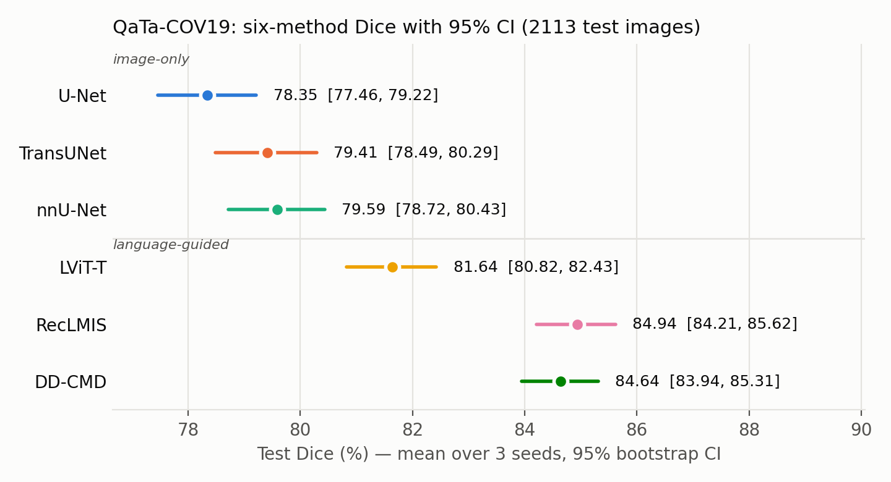
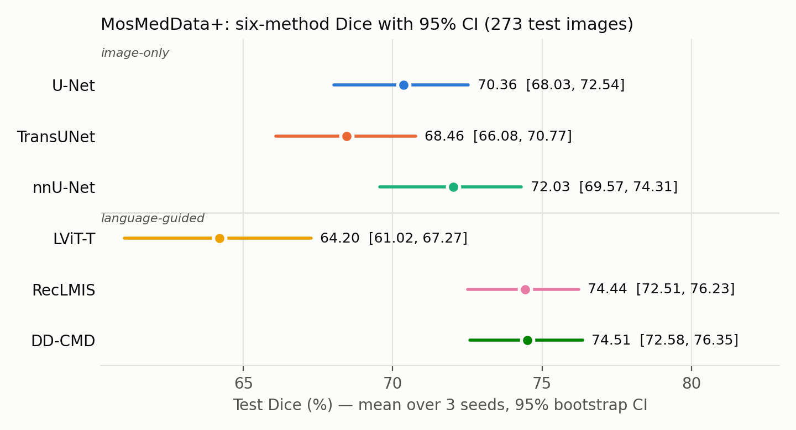
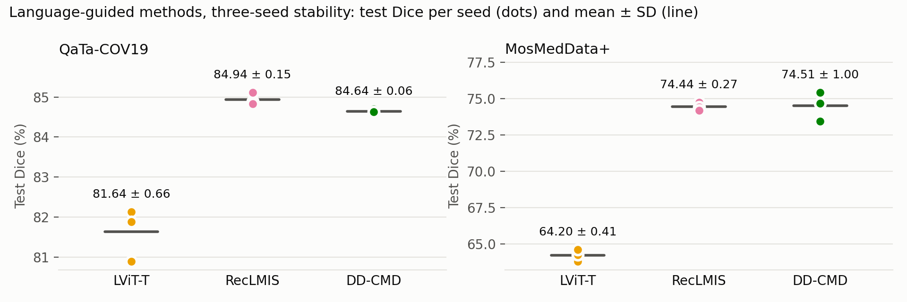
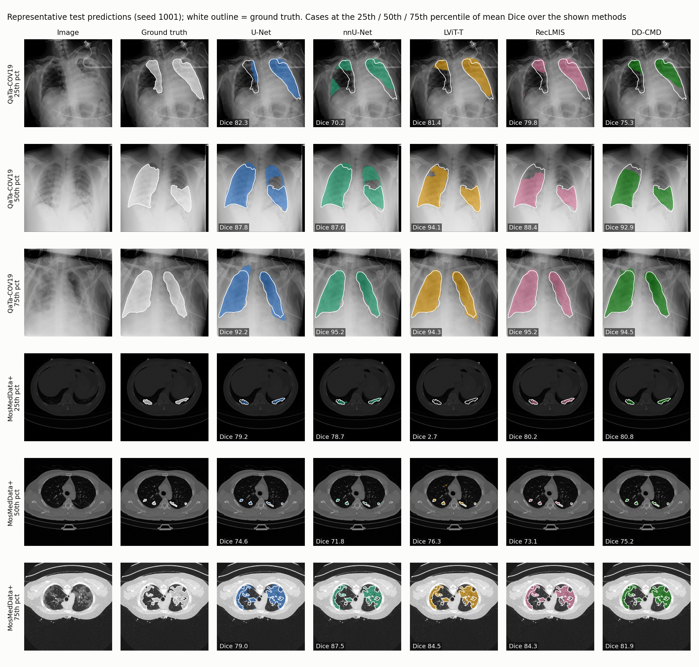

# Phase 1: Language-Guided Medical Image Segmentation — Results

This file follows the structure of the Phase 1 instructions. Each task briefly describes what was done, fills in
the task's table with the actual results, and the file ends with the findings and conclusions.

## Goal

Reproduce three representative language-guided segmentation methods and compare them with the Phase 0 image-only
baselines.

- **Language-guided methods:** LViT-T, RecLMIS, DD-CMD.
- **Datasets:** QaTa-COV19 and MosMedData+ (LViT split).
- **Seeds:** 1001, 1002, 1003.
- **Runs:** 3 methods × 2 datasets × 3 seeds = 18 runs.
- **Final benchmark:** 6 methods, image-only (U-Net, TransUNet, nnU-Net) and language-guided (LViT-T, RecLMIS,
  DD-CMD).

Status: **complete**. All 18 runs are finished and evaluated, the six-method analysis is done, and every checklist
item is met.

---

# Public Implementations

All three methods use the official repositories, pinned as git submodules in `external/`. The upstream code is not
modified: wrappers in `src/phase1/` import the official dataset classes, text pipelines, models, losses and
schedulers.

| Method | Repository | Version |
|---|---|---|
| LViT-T | `HUANGLIZI/LViT` | commit `ba90775` |
| RecLMIS | `ShawnHuang497/RecLMIS` (official CLIP ViT-B/32 weights) | commit `d3265c8` |
| DD-CMD | `maklachur/DD-CMD` | commit `27387c4` |

---

# Task 1.1: Prepare the Data and Repositories

Phase 1 uses the same splits and the same common 224×224 images and masks as Phase 0; no new split was created.
The only addition is each image's text annotation from the LViT dataset package, copied verbatim
(`data/splits/*_text.csv`).

| Dataset | Train | Validation | Test | Text Available |
|---|---:|---:|---:|---|
| QaTa-COV19 | 5716 | 1429 | 2113 | Yes |
| MosMedData+ | 2183 | 273 | 273 | Yes |

Every image has exactly one text, and every spreadsheet row is used once.

**Pairing check.** Each text says whether the infection is unilateral, bilateral or absent. This agrees with the
lesion position in the mask for 96–99% of images on every split. With the texts randomly shuffled, agreement drops
to 49–68%, so each text belongs to the right image.

Details: `reports/PHASE1_DATA_SUMMARY.md`.

---

# Task 1.2: Reproduce LViT-T

The official LViT-T training design is used: model `LViT`, repository `Config.py`, Dice + BCE loss, Adam, cosine
schedule. The text is embedded with frozen BERT. Each item below was checked on both datasets
(`src/phase1/train_lvit.py --quick`).

1. **Image, mask and text pairing.** The official loader finds every image with its own mask and its own text. On
   16 random samples per split, the loaded image, mask and text embedding equal the expected values.
2. **Forward pass.** It works: a batch of 2 gives a 2×1×224×224 output with a finite loss.
3. **Text reaches the language branch.** The segmentation loss sends non-zero gradients through every text module
   and through the layer where text is added to the image tokens.
4. **Training loss decreases.** Short subset check: 0.47 → 0.28 (QaTa), 0.54 → 0.19 (MosMed).
5. **Validation Dice improves.** Short subset check: 0.50 → 0.65 (QaTa), 0.55 → 0.76 (MosMed).
6. **Predicted masks are valid.** All are 224×224 binary masks, one per image.

**Configuration frozen** in `configs/lvit.yaml`: batch 2 and learning rate 3e-4 for both datasets, as in the
repository.

---

# Task 1.3: Reproduce RecLMIS

The official QaTa and MosMed configurations from the repository are used, with the official CLIP ViT-B/32 text
encoder (frozen). Each item below was checked on both datasets (`src/phase1/train_reclmis.py --quick`).

1. **Image, mask and text pairing.** The pairing is correct. On 16 random samples per split, image, mask and CLIP
   tokens equal the expected values.
2. **Official CLIP component.** It loads correctly: all 302 CLIP tensors equal the official `ViT-B-32.pt`. They
   are frozen and unchanged after training.
3. **Forward pass.** It works: the output is 32×1×224×224 (20 on MosMed), and all four losses are finite.
4. **Conditioned reconstruction and fusion are active.** The reconstruction branch stayed on in every epoch of
   every run, its losses are non-zero, and gradients reach the fusion and reconstruction modules.
5. **Training behaves normally.** The loss falls (5.6 → 3.0 QaTa, 5.4 → 2.6 MosMed), with no NaN.
6. **Validation predictions are valid.** All are 224×224 binary masks; validation Dice rose to 0.59 (QaTa) and
   0.70 (MosMed) on the short check.

**Configuration frozen** in `configs/reclmis.yaml`, using the repository's dataset-specific config files.

---

# Task 1.4: Reproduce DD-CMD

The official configuration file `config/train.yaml` is used as given: AdamW, lr 5e-5, batch 8, 160 epochs, a
ConvNeXt-Tiny image encoder and a frozen BiomedBERT text encoder. Each item below was checked on both datasets
(`src/phase1/train_ddcmd.py --quick`).

1. **Image, mask and text pairing.** The pairing is correct. On 16 random samples per split, image, mask and
   BiomedBERT tokens equal the expected values.
2. **Official model and text encoder.** They load correctly: all BiomedBERT and ConvNeXt-Tiny tensors equal the
   pinned checkpoints. The text encoder is frozen and the image encoder is trainable.
3. **Forward pass.** It works: the output is 8×1×224×224 with a finite loss.
4. **Cross-modal decoder is active.** Text-guided gated attention and frequency modulation run at all 3 decoder
   stages, and gradients reach every cross-modal module.
5. **Training behaves normally.** The loss falls (0.69 → 0.30 QaTa, 0.89 → 0.40 MosMed).
6. **Validation predictions are valid.** All are 224×224 binary masks; validation Dice rose to 0.78 (QaTa) and
   0.76 (MosMed) on the short check.

**Configuration frozen** in `configs/ddcmd.yaml`. The only change: the checkpoint is selected by validation Dice
instead of the repository's validation mIoU, as the instructions require.

---

# Task 1.5: Model Setup Summary

| Method | Repository | Input | Text Encoder | Main Cross-Modal Mechanism | Notes |
|---|---|---|---|---|---|
| LViT-T | HUANGLIZI/LViT | 224×224 | BERT-base (frozen), first 10 token embeddings | LViT fusion | text embeddings are added to the image tokens and propagated through the ViT/CNN double U-shape; 39.9M parameters; Adam, lr 3e-4, batch 2 |
| RecLMIS | ShawnHuang497/RecLMIS | 224×224 | CLIP ViT-B/32 text transformer (frozen), 18 tokens | conditioned reconstruction | text↔image cross-attention feeds the decoder; masked text and image features are reconstructed during training; Adam, lr 3e-4, batch 32 / 20 |
| DD-CMD | maklachur/DD-CMD | 224×224 | BiomedBERT (frozen), 24 tokens | dual-domain gated decoding | gated text cross-attention + text-conditioned frequency (DCT) modulation at 3 decoder stages; ConvNeXt-Tiny encoder; AdamW, lr 5e-5, batch 8 |

All methods select the checkpoint by the same validation Dice as Phase 0. No test data was used for any setting.
Details and all decisions: `reports/PHASE1_MODEL_SETUP.md`.

---

# Task 1.6: Run the 18 Main Experiments

All 18 runs were trained on RTX 3090 GPUs (Nov 14–17, 2026). Each cell shows that the run is complete (✅) and its
test Dice (%).

| Method | Dataset | Seed 1001 | Seed 1002 | Seed 1003 |
|---|---|---|---|---|
| LViT-T | QaTa-COV19 | ✅ 82.14 | ✅ 80.89 | ✅ 81.89 |
| RecLMIS | QaTa-COV19 | ✅ 84.88 | ✅ 84.82 | ✅ 85.11 |
| DD-CMD | QaTa-COV19 | ✅ 84.60 | ✅ 84.70 | ✅ 84.63 |
| LViT-T | MosMedData+ | ✅ 63.78 | ✅ 64.24 | ✅ 64.59 |
| RecLMIS | MosMedData+ | ✅ 74.72 | ✅ 74.40 | ✅ 74.20 |
| DD-CMD | MosMedData+ | ✅ 73.44 | ✅ 75.42 | ✅ 74.67 |

Every run saved its training log, best checkpoint (by validation Dice), test summary, per-case metrics and predicted
masks, in `runs/<method>/<dataset>/seed_<seed>/`. These files are kept on the server, not in git. The test set was
predicted once per run, after training. When reloaded, each best checkpoint reproduced its validation Dice
exactly.

---

# Task 1.7: Common Final Evaluation

All six methods (36 runs: Phase 0 and Phase 1) are scored by the same evaluator as Phase 0:
- evaluation size 224×224, binary threshold 0.5;
- metrics Dice, mIoU, HD95 and ASSD.

A check over all 36 runs (`results/phase1_evaluation_check.csv`) confirmed that:
- every run uses the same test samples and the same target masks (verified by file hash);
- every run has one 224×224 binary prediction per test image;
- every stored metric equals the value recomputed from the saved prediction.

---

# Task 1.8: Phase 1 Result Table

Output: `results/phase1_main_results.csv`.
- Dice and mIoU are in %; HD95 and ASSD are in pixels (lower is better).
- Mean ± SD is across the 3 seeds.
- Dice 95% CI is a bootstrap over test images.

| Dataset | Method | Dice Mean ± SD | Dice 95% CI | mIoU | HD95 | ASSD |
|---|---|---|---|---:|---:|---:|
| QaTa-COV19 | LViT-T | 81.64 ± 0.66 | [80.82, 82.43] | 72.75 ± 0.78 | 20.78 ± 0.71 | 7.94 ± 0.21 |
| QaTa-COV19 | RecLMIS | 84.94 ± 0.15 | [84.21, 85.62] | 76.69 ± 0.19 | 13.53 ± 0.56 | 4.08 ± 0.34 |
| QaTa-COV19 | DD-CMD | 84.64 ± 0.06 | [83.94, 85.31] | 76.20 ± 0.08 | 13.65 ± 0.25 | 3.98 ± 0.11 |
| MosMedData+ | LViT-T | 64.20 ± 0.41 | [61.02, 67.27] | 52.42 ± 0.88 | 44.54 ± 12.19 | 31.95 ± 14.10 |
| MosMedData+ | RecLMIS | 74.44 ± 0.27 | [72.51, 76.23] | 61.59 ± 0.39 | 17.57 ± 1.01 | 5.23 ± 0.16 |
| MosMedData+ | DD-CMD | 74.51 ± 1.00 | [72.58, 76.35] | 61.60 ± 1.04 | 16.76 ± 1.25 | 4.89 ± 0.98 |

---

# Task 1.9: Final Six-Method Comparison

Output: `results/final_six_method_results.csv`. This is the main benchmark table. The Phase 0 rows are identical to
the Phase 0 results.

| Dataset | Method | Text at Train | Text at Test | Dice Mean ± SD | Dice 95% CI | mIoU | HD95 | ASSD |
|---|---|---|---|---|---|---:|---:|---:|
| QaTa-COV19 | U-Net | No | No | 78.35 ± 0.24 | [77.46, 79.22] | 68.73 ± 0.25 | 32.30 ± 0.66 | 11.02 ± 0.49 |
| QaTa-COV19 | TransUNet | No | No | 79.41 ± 0.22 | [78.49, 80.29] | 70.27 ± 0.15 | 29.02 ± 0.37 | 9.41 ± 0.99 |
| QaTa-COV19 | nnU-Net | No | No | 79.59 ± 0.43 | [78.72, 80.43] | 70.23 ± 0.49 | 29.29 ± 1.10 | 9.08 ± 1.14 |
| QaTa-COV19 | LViT-T | Yes | Yes | 81.64 ± 0.66 | [80.82, 82.43] | 72.75 ± 0.78 | 20.78 ± 0.71 | 7.94 ± 0.21 |
| QaTa-COV19 | RecLMIS | Yes | Yes | **84.94 ± 0.15** | [84.21, 85.62] | **76.69 ± 0.19** | **13.53 ± 0.56** | 4.08 ± 0.34 |
| QaTa-COV19 | DD-CMD | Yes | Yes | 84.64 ± 0.06 | [83.94, 85.31] | 76.20 ± 0.08 | 13.65 ± 0.25 | **3.98 ± 0.11** |
| MosMedData+ | U-Net | No | No | 70.36 ± 2.25 | [68.03, 72.54] | 57.44 ± 2.05 | 27.14 ± 6.69 | 12.97 ± 6.47 |
| MosMedData+ | TransUNet | No | No | 68.46 ± 0.81 | [66.08, 70.77] | 55.21 ± 0.82 | 25.93 ± 3.01 | 12.12 ± 3.48 |
| MosMedData+ | nnU-Net | No | No | 72.03 ± 1.22 | [69.57, 74.31] | 59.58 ± 1.11 | 22.86 ± 2.80 | 9.48 ± 3.03 |
| MosMedData+ | LViT-T | Yes | Yes | 64.20 ± 0.41 | [61.02, 67.27] | 52.42 ± 0.88 | 44.54 ± 12.19 | 31.95 ± 14.10 |
| MosMedData+ | RecLMIS | Yes | Yes | 74.44 ± 0.27 | [72.51, 76.23] | 61.59 ± 0.39 | 17.57 ± 1.01 | 5.23 ± 0.16 |
| MosMedData+ | DD-CMD | Yes | Yes | **74.51 ± 1.00** | [72.58, 76.35] | **61.60 ± 1.04** | **16.76 ± 1.25** | **4.89 ± 0.98** |

Bold: best per dataset and metric.

---

# Task 1.10: Statistical Comparison

Output: `results/final_six_method_pairwise.csv` (15 pairs per dataset). For each pair, the method is:
1. each test image's Dice is averaged across the 3 seeds within each method;
2. the same images are aligned;
3. the paired difference A − B is computed (in percentage points).

- **95% CI:** paired bootstrap over test images.
- **Raw p:** two-sided Wilcoxon signed-rank test.
- **Holm p:** correction across the 15 comparisons within each dataset.

| Dataset | Method A | Method B | ΔDice | 95% CI | Raw p | Holm p |
|---|---|---|---:|---|---:|---:|
| QaTa-COV19 | U-Net | TransUNet | −1.06 | [−1.45, −0.66] | 1.3e-22 | 8.0e-22 |
| QaTa-COV19 | U-Net | nnU-Net | −1.25 | [−1.65, −0.85] | 4.1e-21 | 2.0e-20 |
| QaTa-COV19 | U-Net | LViT-T | −3.29 | [−3.77, −2.83] | 6.6e-67 | 4.6e-66 |
| QaTa-COV19 | U-Net | RecLMIS | −6.60 | [−7.11, −6.10] | 2.9e-202 | 4.3e-201 |
| QaTa-COV19 | U-Net | DD-CMD | −6.30 | [−6.84, −5.76] | 2.4e-164 | 3.3e-163 |
| QaTa-COV19 | TransUNet | nnU-Net | −0.19 | [−0.61, +0.23] | 0.019 | 0.019 |
| QaTa-COV19 | TransUNet | LViT-T | −2.23 | [−2.75, −1.69] | 3.3e-10 | 1.3e-9 |
| QaTa-COV19 | TransUNet | RecLMIS | −5.53 | [−6.08, −5.00] | 4.6e-118 | 5.6e-117 |
| QaTa-COV19 | TransUNet | DD-CMD | −5.24 | [−5.76, −4.72] | 4.8e-94 | 4.8e-93 |
| QaTa-COV19 | nnU-Net | LViT-T | −2.05 | [−2.56, −1.52] | 9.4e-9 | 2.8e-8 |
| QaTa-COV19 | nnU-Net | RecLMIS | −5.35 | [−5.86, −4.83] | 1.9e-97 | 2.1e-96 |
| QaTa-COV19 | nnU-Net | DD-CMD | −5.05 | [−5.56, −4.55] | 1.7e-83 | 1.3e-82 |
| QaTa-COV19 | LViT-T | RecLMIS | −3.30 | [−3.69, −2.94] | 6.4e-137 | 8.3e-136 |
| QaTa-COV19 | LViT-T | DD-CMD | −3.00 | [−3.40, −2.62] | 1.4e-89 | 1.3e-88 |
| QaTa-COV19 | RecLMIS | DD-CMD | +0.30 | [+0.01, +0.58] | 2.1e-5 | 4.2e-5 |
| MosMedData+ | U-Net | TransUNet | +1.90 | [−0.26, +3.98] | 3.4e-4 | 0.003 |
| MosMedData+ | U-Net | nnU-Net | −1.67 | [−3.69, +0.25] | 0.55 | 1.00 |
| MosMedData+ | U-Net | LViT-T | +6.16 | [+4.20, +8.19] | 5.1e-6 | 5.6e-5 |
| MosMedData+ | U-Net | RecLMIS | −4.08 | [−5.99, −2.29] | 0.003 | 0.018 |
| MosMedData+ | U-Net | DD-CMD | −4.15 | [−6.10, −2.37] | 6.2e-4 | 0.005 |
| MosMedData+ | TransUNet | nnU-Net | −3.57 | [−4.69, −2.46] | 7.8e-17 | 1.0e-15 |
| MosMedData+ | TransUNet | LViT-T | +4.26 | [+0.91, +7.72] | 0.10 | 0.31 |
| MosMedData+ | TransUNet | RecLMIS | −5.98 | [−7.45, −4.57] | 6.8e-20 | 9.5e-19 |
| MosMedData+ | TransUNet | DD-CMD | −6.05 | [−7.43, −4.79] | 2.5e-25 | 3.7e-24 |
| MosMedData+ | nnU-Net | LViT-T | +7.83 | [+4.67, +11.16] | 0.021 | 0.12 |
| MosMedData+ | nnU-Net | RecLMIS | −2.41 | [−3.62, −1.29] | 0.050 | 0.20 |
| MosMedData+ | nnU-Net | DD-CMD | −2.48 | [−3.70, −1.39] | 0.025 | 0.13 |
| MosMedData+ | LViT-T | RecLMIS | −10.24 | [−13.40, −7.26] | 1.5e-4 | 0.002 |
| MosMedData+ | LViT-T | DD-CMD | −10.31 | [−13.47, −7.35] | 2.5e-6 | 3.0e-5 |
| MosMedData+ | RecLMIS | DD-CMD | −0.07 | [−0.83, +0.65] | 0.63 | 1.00 |

**mIoU, HD95 and ASSD** (paired differences A − B with 95% CI). For HD95 and ASSD, a positive value means A has the
larger (worse) distance.

| Dataset | Method A | Method B | ΔmIoU (95% CI) | ΔHD95 px (95% CI) | ΔASSD px (95% CI) |
|---|---|---|---|---|---|
| QaTa-COV19 | U-Net | TransUNet | −1.54 [−1.94, −1.13] | +3.27 [+2.13, +4.42] | +1.62 [+0.76, +2.55] |
| QaTa-COV19 | U-Net | nnU-Net | −1.49 [−1.93, −1.05] | +3.01 [+1.90, +4.13] | +1.95 [+1.09, +2.84] |
| QaTa-COV19 | U-Net | LViT-T | −4.02 [−4.50, −3.53] | +11.52 [+10.05, +13.02] | +3.08 [+1.89, +4.31] |
| QaTa-COV19 | U-Net | RecLMIS | −7.95 [−8.48, −7.43] | +18.76 [+17.28, +20.31] | +6.94 [+5.84, +8.15] |
| QaTa-COV19 | U-Net | DD-CMD | −7.47 [−8.01, −6.93] | +18.65 [+17.16, +20.18] | +7.05 [+5.96, +8.25] |
| QaTa-COV19 | TransUNet | nnU-Net | +0.04 [−0.44, +0.50] | −0.26 [−1.36, +0.79] | +0.33 [−0.46, +1.10] |
| QaTa-COV19 | TransUNet | LViT-T | −2.48 [−3.02, −1.93] | +8.24 [+6.79, +9.75] | +1.47 [+0.32, +2.60] |
| QaTa-COV19 | TransUNet | RecLMIS | −6.42 [−6.97, −5.88] | +15.49 [+14.14, +16.90] | +5.32 [+4.40, +6.29] |
| QaTa-COV19 | TransUNet | DD-CMD | −5.93 [−6.49, −5.38] | +15.37 [+13.98, +16.74] | +5.43 [+4.58, +6.38] |
| QaTa-COV19 | nnU-Net | LViT-T | −2.52 [−3.06, −1.98] | +8.50 [+7.10, +9.92] | +1.14 [+0.09, +2.20] |
| QaTa-COV19 | nnU-Net | RecLMIS | −6.46 [−7.02, −5.90] | +15.75 [+14.43, +17.12] | +4.99 [+4.17, +5.89] |
| QaTa-COV19 | nnU-Net | DD-CMD | −5.97 [−6.52, −5.44] | +15.64 [+14.31, +16.96] | +5.10 [+4.32, +5.93] |
| QaTa-COV19 | LViT-T | RecLMIS | −3.94 [−4.31, −3.57] | +7.25 [+6.21, +8.33] | +3.86 [+2.92, +4.88] |
| QaTa-COV19 | LViT-T | DD-CMD | −3.45 [−3.84, −3.06] | +7.13 [+6.08, +8.24] | +3.97 [+3.07, +4.98] |
| QaTa-COV19 | RecLMIS | DD-CMD | +0.49 [+0.18, +0.80] | −0.12 [−0.66, +0.43] | +0.11 [−0.24, +0.49] |
| MosMedData+ | U-Net | TransUNet | +2.23 [+0.21, +4.19] | +1.21 [−4.33, +6.64] | +0.86 [−4.56, +6.31] |
| MosMedData+ | U-Net | nnU-Net | −2.14 [−4.08, −0.26] | +4.28 [−0.64, +9.24] | +3.49 [−1.42, +8.35] |
| MosMedData+ | U-Net | LViT-T | +5.02 [+3.33, +6.74] | −17.40 [−24.53, −10.66] | −18.98 [−26.42, −12.15] |
| MosMedData+ | U-Net | RecLMIS | −4.15 [−5.99, −2.42] | +9.57 [+5.53, +13.99] | +7.74 [+4.02, +12.00] |
| MosMedData+ | U-Net | DD-CMD | −4.16 [−6.00, −2.42] | +10.38 [+6.12, +15.00] | +8.08 [+4.31, +12.47] |
| MosMedData+ | TransUNet | nnU-Net | −4.37 [−5.52, −3.23] | +3.07 [+0.26, +6.34] | +2.63 [+0.22, +5.57] |
| MosMedData+ | TransUNet | LViT-T | +2.79 [−0.15, +5.83] | −18.61 [−27.96, −9.57] | −19.83 [−28.72, −10.98] |
| MosMedData+ | TransUNet | RecLMIS | −6.38 [−7.72, −5.05] | +8.36 [+3.86, +13.57] | +6.89 [+2.49, +11.95] |
| MosMedData+ | TransUNet | DD-CMD | −6.39 [−7.69, −5.16] | +9.17 [+5.07, +13.98] | +7.23 [+3.38, +11.76] |
| MosMedData+ | nnU-Net | LViT-T | +7.16 [+4.31, +10.12] | −21.68 [−30.51, −13.14] | −22.47 [−31.51, −13.93] |
| MosMedData+ | nnU-Net | RecLMIS | −2.00 [−3.19, −0.87] | +5.28 [+1.44, +9.74] | +4.25 [+0.74, +8.61] |
| MosMedData+ | nnU-Net | DD-CMD | −2.02 [−3.18, −0.94] | +6.10 [+2.73, +10.07] | +4.59 [+1.67, +8.30] |
| MosMedData+ | LViT-T | RecLMIS | −9.17 [−12.00, −6.53] | +26.97 [+18.84, +35.68] | +26.72 [+18.30, +35.58] |
| MosMedData+ | LViT-T | DD-CMD | −9.18 [−11.91, −6.56] | +27.79 [+19.86, +36.31] | +27.06 [+19.39, +35.80] |
| MosMedData+ | RecLMIS | DD-CMD | −0.01 [−0.75, +0.73] | +0.82 [−1.68, +3.04] | +0.34 [−1.72, +2.01] |

---

# Task 1.11: Interpret the Results

1. **Best on QaTa-COV19: RecLMIS** (Dice 84.94). DD-CMD is a close second (84.64). Their difference is small
   (+0.30 points) but significant, and the two do not differ in HD95 or ASSD. Both are at least 3 points ahead of
   all other methods.
2. **Best on MosMedData+: DD-CMD and RecLMIS, tied** (74.51 and 74.44; Holm p = 1.00). Both lead nnU-Net, the best
   image-only method (72.03), by about 2.5 points. This lead is not significant after Holm correction.
3. **The image-only baselines are strong.**
   - On QaTa-COV19, nnU-Net and TransUNet are within about 2 points of LViT-T.
   - On MosMedData+, all three image-only methods beat LViT-T, and nnU-Net is close to the two best methods.
4. **Language-guided methods do not consistently outperform image-only methods.**
   - On QaTa-COV19 they do: all 9 language vs image-only pairs are significant, with gains of 2.0–6.6 points.
   - On MosMedData+ they don't. RecLMIS and DD-CMD beat U-Net and TransUNet but not nnU-Net (significance), and
     LViT-T is below all three image-only methods.
5. **DD-CMD does not change the conclusion.** It matches RecLMIS rather than surpassing it, and both are well ahead
   of LViT-T. The pattern is the same with or without DD-CMD.
6. **Seed stability.** Dice SD across seeds is:

   | | LViT-T | RecLMIS | DD-CMD | Image-only |
   |---|---:|---:|---:|---:|
   | QaTa-COV19 | 0.66 | 0.15 | **0.06** | 0.22–0.43 |
   | MosMedData+ | 0.41 | **0.27** | 1.00 | 0.81–2.25 |

   - **RecLMIS** is the most stable overall.
   - **DD-CMD** is the most stable on QaTa-COV19 but varies more on MosMedData+.
   - **LViT-T** is the least stable on QaTa-COV19. On MosMedData+ its Dice is steady, but its HD95 and ASSD vary a
     lot between seeds.
7. **Boundary metrics agree with Dice.** No pair has HD95 or ASSD pointing the opposite way to Dice with both
   differences significant. Boundary metrics penalize completely missed lesions strongly, which is why LViT-T's
   HD95 on MosMedData+ (44.5 px) is far worse than every other method's.
8. **Significant after Holm.**
   - **QaTa-COV19:** all 15 pairs. TransUNet vs nnU-Net is significant but negligible: its CI includes 0.
   - **MosMedData+:** 9 of 15 pairs. Not significant: U-Net vs nnU-Net, TransUNet vs LViT-T, nnU-Net vs LViT-T,
     nnU-Net vs RecLMIS, nnU-Net vs DD-CMD, and RecLMIS vs DD-CMD.

**Note on text.** These comparisons are between different architectures, so they do not show that the text itself
causes the improvement. Phase 2 will test text dependence within the same frozen model.

---

# Required Figures

1. Six-method Dice comparison on QaTa-COV19

   

2. Six-method Dice comparison on MosMedData+

   

3. Seed stability for the three language-guided methods

   

Optional: representative predictions of U-Net, nnU-Net, LViT-T, RecLMIS and DD-CMD. The examples were chosen by
percentile, not by hand.

---

# Milestones

| Milestone | Expected | Status |
|---|---|---|
| 1.1 Data and Repositories Ready | official splits loaded; text annotations paired correctly; all three official repositories available | ✅ |
| 1.2 Three Language-Guided Methods Reproduced | LViT-T, RecLMIS and DD-CMD run correctly; final configs fixed | ✅ |
| 1.3 18 Runs Complete | 18 / 18 runs complete | ✅ 18 / 18 |
| 1.4 Final Six-Method Analysis Complete | `results/phase1_main_results.csv`, `results/final_six_method_results.csv`, `results/final_six_method_pairwise.csv`, `reports/PHASE1_RESULTS.md` | ✅ |

---

# Phase 1 Completion Checklist

- [x] LViT-T reproduction is complete.
- [x] RecLMIS reproduction is complete.
- [x] DD-CMD reproduction is complete.
- [x] all 18 Phase 1 runs are complete.
- [x] all three seeds are included.
- [x] common 224×224 evaluation is used.
- [x] test predictions and per-case metrics are saved.
- [x] final six-method table is complete.
- [x] all 15 pairwise comparisons are complete for QaTa-COV19.
- [x] all 15 pairwise comparisons are complete for MosMedData+.
- [x] `PHASE1_RESULTS.md` is complete.

---

# Findings and Conclusions

1. **Strong language-guided methods clearly beat the image-only baselines on QaTa-COV19.** RecLMIS (84.94) and
   DD-CMD (84.64) are about 5 points above nnU-Net (79.59), on every metric.
2. **On MosMedData+ the advantage is small and uncertain.** RecLMIS and DD-CMD lead nnU-Net by about 2.5 points,
   but this is not significant after correction.
3. **The choice of language-guided method matters more than using text at all.** LViT-T is about 3 points behind
   RecLMIS and DD-CMD on QaTa-COV19, and 10 points behind on MosMedData+, where it is below all image-only
   baselines.
4. **DD-CMD, the most recent method, matches RecLMIS but does not surpass it.**
5. **Reproduction quality.** Our results are close to the published ones. Each method is compared under its
   paper's way of computing Dice (details: `reports/PHASE1_RESULTS.md`, `results/phase1_published_comparison.csv`).

   | | QaTa-COV19: ours / published | MosMedData+: ours / published |
   |---|---|---|
   | U-Net | 78.35 / 79.02 | 70.36 / 64.60 |
   | TransUNet | 79.41 / 78.63 | 68.46 / 71.24 |
   | nnU-Net | 79.59 / 80.42 | 72.03 / 72.59 |
   | LViT-T | 81.64 / 83.66 | **64.20 / 74.57** |
   | RecLMIS | 84.94 / 85.22 | 74.44 / 77.48 |
   | DD-CMD | 91.21 / 91.46 (whole-dataset Dice) | 80.89 / 81.95 (whole-dataset Dice) |

   - On QaTa-COV19, all methods are within 2 points of the published values.
   - On MosMedData+, all methods except one are within 3 points, as expected for a 273-image test set.
   - **The exception is LViT-T on MosMedData+ (−10.4).** It misses the lesion entirely on more images than the
     other methods. A plausible cause is that we followed the repository's training settings (batch 2, lr 3e-4)
     rather than the paper's MosMedData+ settings (batch 24, lr 1e-3). The result is reported as obtained. It can
     be re-run with the paper's settings as a separate check, choosing between the two by validation Dice only.
6. **Caveat.** The language-guided methods also differ from the baselines in architecture and pretraining, so these
   results do not show that the text causes the gains. Phase 2 tests this directly.

Phase 1 is complete and frozen. Detailed reports: `reports/PHASE1_DATA_SUMMARY.md`,
`reports/PHASE1_MODEL_SETUP.md`, `reports/PHASE1_RESULTS.md`.
